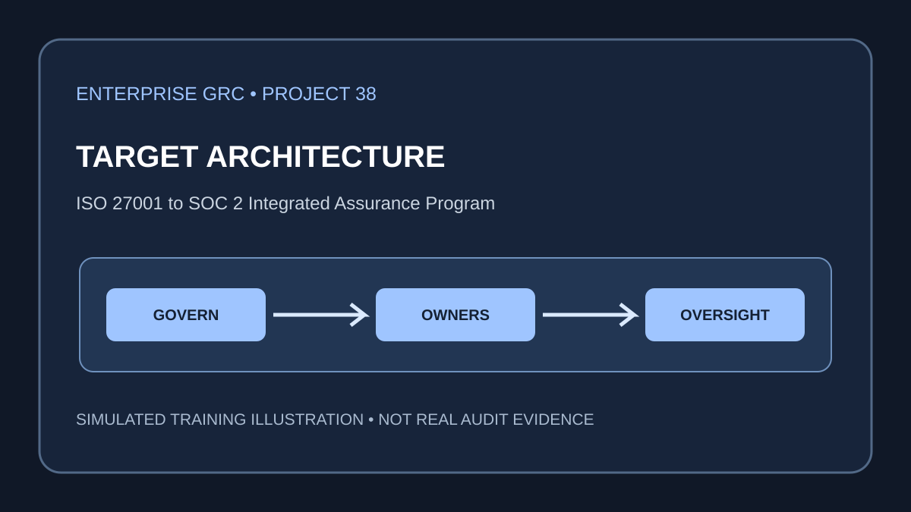

# Project 38: ISO 27001 to SOC 2 Integrated Assurance Program

**Level:** Advanced | **Track:** Enterprise GRC & Security Compliance

## Objective
Architect and evaluate an enterprise-scale iso 27001 to soc 2 integrated assurance program capability. Integrate governance, risk, control ownership, evidence, executive decisions, and continuous improvement across multiple business functions.

## Scope and authorization
Use a fictional enterprise and synthetic data. Define entities, business services, jurisdictions, technology boundaries, suppliers, data classes, shared services, assumptions, and exclusions. Do not publish real confidential or regulated information. This exercise is not legal advice, certification, an audit opinion, or a substitute for qualified professional review.

## Prerequisites
- Approved enterprise context and stakeholder map
- Current authoritative frameworks, laws, contracts, and source editions
- GRC workspace, document control, workflow/diagramming tools, and synthetic data
- Defined risk appetite, governance forums, escalation, and approval authorities

## Lab setup
1. Establish project charter, scope boundary, assumptions, and design principles.
2. Map business services, entities, systems, data flows, dependencies, and third parties.
3. Define roles for board/committee, executives, risk owners, control owners, internal audit, and external assessors as appropriate.
4. Create linked registers for obligations, risks, controls, evidence, exceptions, findings, and actions.
5. Define data quality, access controls, retention, change management, and review cadence.

## Walkthrough
### 1. Design the target operating model
Document governance forums, decision rights, accountability, escalation paths, and segregation of duties. Distinguish first-line ownership, second-line oversight, and independent assurance where the three-lines model applies.

### 2. Establish integrated requirements
Identify authoritative obligations and business commitments. Normalize them into traceable outcomes without copying restricted standards. Record jurisdiction, applicability, source edition, effective date, owner, and review trigger.

### 3. Build an enterprise control architecture
Define control objectives, common controls, local controls, inherited/shared controls, system boundaries, owners, frequency, evidence, and test procedures. Identify control dependencies and single points of failure.

### 4. Integrate risk decisions
Set risk taxonomy, appetite/tolerance, scoring, aggregation, escalation thresholds, treatment options, and acceptance authority. Model inherent and residual risk with assumptions and confidence levels.

### 5. Operationalize evidence and assurance
Design evidence ownership, collection, quality checks, access restrictions, retention, sampling, reviewer independence, and issue management. Separate management self-assessment from independent assurance.

### 6. Measure and report
Create metrics for coverage, control performance, risk exposure, exceptions, overdue actions, and remediation effectiveness. Explain formulas, denominators, thresholds, data sources, and limitations.

### 7. Exercise governance and improve
Run a fictional steering committee review or tabletop. Capture decisions, challenge assumptions, assign actions, and update the roadmap. Define periodic design review and trigger-based updates.

## Example enterprise register
| ID | Domain | Accountable role | Evidence | Risk / status | Decision |
|---|---|---|---|---|---|
| ENT-001 | Governance | Executive sponsor | GOV-001 | Baseline | Approve model |
| ENT-002 | Control assurance | Control owner | CTRL-001 | To test | Validate design |
| ENT-003 | Risk treatment | Risk owner | RISK-001 | Pending | Accept or treat |

## Tools and analysis
Use process maps, RACI, obligation/control crosswalks, risk heat maps, dependency maps, evidence catalogs, dashboards, and workflow automation. Apply data validation and access controls. Synthetic scripts can test register integrity, stale records, orphaned controls, and overdue actions.

## Expected output
An enterprise target operating model, integrated control architecture, risk methodology, assurance lifecycle, evidence governance, reporting model, and multi-phase implementation roadmap.

## Findings and risk assessment
Assess governance fragmentation, inconsistent criteria, unclear accountability, duplicated controls, evidence gaps, weak oversight, risk aggregation blind spots, and unapproved exceptions. Prioritize by business impact, systemic reach, regulatory exposure, and resilience.

## Framework mapping
Consider relevant requirements across ISO/IEC 27001:2022, NIST CSF 2.0, NIST SP 800-53 Rev. 5, CIS Controls v8, SOC 2 Trust Services Criteria, and applicable laws/contracts. Record exact editions and mapping rationale. Framework crosswalks are not proof of compliance or equivalence.

## Remediation
Create a sequenced roadmap with accountable executive sponsor, workstream owners, dependencies, resources, milestones, target outcomes, interim safeguards, and objective evidence. Escalate material residual risk through the approved governance forum.

## Validation criteria
- Enterprise scope and governance are formally approved
- Decision rights and ownership are unambiguous
- Obligations trace to control objectives and evidence
- Risk appetite and escalation thresholds are documented
- Assurance roles preserve appropriate independence
- Metrics have defined sources, formulas, and limitations
- Roadmap actions have owners, funding assumptions, and review gates

## Evidence and reporting checklist
- [ ] Enterprise charter, boundaries, and assumptions
- [ ] Governance model, RACI, and decision records
- [ ] Obligation and control architecture
- [ ] Risk taxonomy, appetite, and risk register
- [ ] Evidence governance and assurance methodology
- [ ] Metrics definitions and executive dashboard
- [ ] Exception, finding, and remediation records
- [ ] Roadmap, milestones, and steering decisions

## Training illustrations
Simulated training illustrations only; they are not actual enterprise evidence.

## Deliverables
1. Enterprise GRC operating model and RACI
2. Integrated obligations and control architecture
3. Enterprise risk methodology and register
4. Assurance, evidence, and reporting model
5. Prioritized implementation roadmap and decision pack

## Completion criteria
The target model is approved, responsibilities and decision rights are clear, control and risk information is traceable, and an independent reviewer can evaluate the design using documented artifacts.
