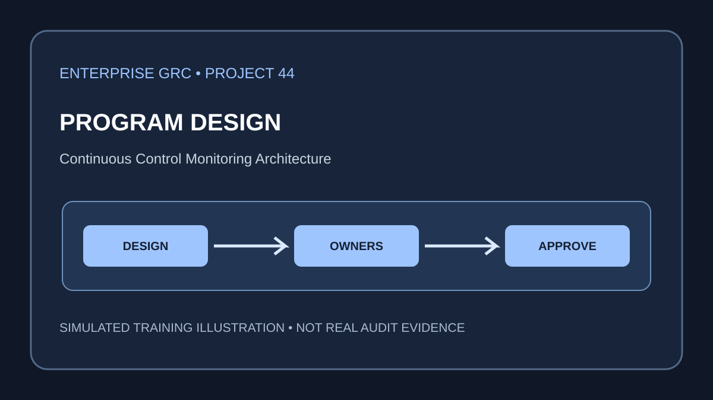

# Project 44: Continuous Control Monitoring Architecture

**Level:** Advanced | **Track:** Enterprise GRC & Security Compliance

## Objective
Develop an enterprise-ready continuous control monitoring architecture program for a fictional organization. Integrate governance, accountable ownership, risk-based prioritization, evidence lifecycle, measurable outcomes, and management oversight.

## Scope and authorization
Use fictional entities, synthetic datasets, and authorized systems. Document business purpose, jurisdictions, services, systems, data classes, third parties, boundaries, exclusions, and assumptions. Do not include real confidential or regulated records. Educational exercise only; not legal advice, certification, or an audit opinion.

## Prerequisites
- Approved enterprise scope and stakeholder map
- Current official laws, standards, contractual criteria, and source editions
- GRC platform or structured registers, evidence repository, workflow and diagram tools
- Synthetic evidence and defined governance/approval authorities

## Lab setup
1. Create charter, scope, obligations, process, controls, evidence, risk, findings, actions, and reporting workspaces.
2. Establish unique IDs, metadata standards, record owners, reviewers, and access roles.
3. Define risk appetite, classification, retention, evidence integrity, review frequency, and escalation.
4. Map dependencies across business services, systems, suppliers, and control owners.
5. Agree on project success measures and independent validation criteria.

## Walkthrough
### 1. Define strategic outcomes
Translate the business need into measurable objectives and expected outcomes. Identify executive sponsor, affected stakeholders, decision rights, constraints, and implementation assumptions.

### 2. Establish obligations and design principles
Identify authoritative requirements and contractual commitments. Record source, edition, jurisdiction, effective date, applicability, owner, and review triggers. Separate binding obligations from voluntary guidance.

### 3. Design the enterprise process
Map the end-to-end workflow, roles, approvals, handoffs, exception handling, escalation, and records. Define preventive, detective, and corrective safeguards and how they integrate with existing governance.

### 4. Build traceability and evidence
Link obligations to control objectives, control owners, test procedures, evidence sources, and review cadence. Define evidence quality, access restrictions, retention, versioning, and chain-of-custody considerations where relevant.

### 5. Evaluate risk and operating performance
Use synthetic scenarios and samples to test design and operation. Record population, selection rationale, test steps, results, exceptions, limitations, risk exposure, and confidence. Avoid treating automation or a dashboard as proof without validated source data.

### 6. Prioritize investment and decisions
Assess residual exposure, dependencies, cost, feasibility, and risk appetite. Assign owners, milestones, resources, interim safeguards, and closure evidence. Record accepted risks with authorized approval, rationale, expiry, and review.

### 7. Establish continuous governance
Define reporting cadence, thresholds, triggers, independent review, change control, and program improvement. Produce a management decision pack with options, trade-offs, limitations, and requested approvals.

## Example program register
| ID | Workstream | Owner | Evidence | Status | Governance action |
|---|---|---|---|---|---|
| PRG-001 | Requirements and scope | Program lead | SCOPE-001 | Draft | Approve boundary |
| PRG-002 | Control operation | Control owner | TEST-001 | To validate | Review sample |
| PRG-003 | Risk and remediation | Risk owner | RISK-001 | Open | Prioritize treatment |

## Tools and checks
Use process maps, RACI, obligation/control matrices, workflow engines, evidence catalogs, risk registers, metrics dashboards, and issue trackers. Validate data lineage, unique IDs, access permissions, stale records, missing owners, overdue actions, and approval history. Use synthetic data for public examples.

## Expected output
An approved enterprise program design with process maps, requirements traceability, control/evidence model, risk analysis, operating metrics, governance cadence, implementation plan, and executive decision pack.

## Findings and risk assessment
Assess systemic dependencies, fragmented ownership, inconsistent interpretation, data quality, control failure, privacy exposure, resilience, and governance blind spots. Quantify only where assumptions and data support the calculation; otherwise use transparent qualitative ranges.

## Framework mapping
Map to applicable requirements from ISO/IEC 27001:2022, NIST CSF 2.0, NIST SP 800-53 Rev. 5, CIS Controls v8, SOC 2 Trust Services Criteria, privacy rules, and sector obligations as relevant. Record exact editions and mapping rationale. Crosswalks are not a substitute for authoritative criteria.

## Remediation
Build a sequenced roadmap with accountable sponsor, workstream owner, milestones, dependencies, resources, interim safeguards, evidence requirements, and validation gates. Escalate material residual risks to the authorized governance forum.

## Validation criteria
- Strategic objectives, scope, and governance are approved
- Obligations and design decisions have traceable sources
- Roles, process steps, and evidence responsibilities are defined
- Risk and performance metrics have transparent methodology
- Exceptions and risk acceptance have approval and expiry
- Implementation milestones have owners and objective outcomes
- Independent review can reproduce sample results

## Evidence and reporting checklist
- [ ] Charter, scope, boundaries, and assumptions
- [ ] Obligations register and authoritative source versions
- [ ] Process maps, RACI, and approval records
- [ ] Control objectives, owners, and evidence catalog
- [ ] Test plans, sample records, and results
- [ ] Risk analysis, exceptions, and treatment decisions
- [ ] Metrics, data lineage, and reporting thresholds
- [ ] Roadmap, governance minutes, and validation results

## Training illustrations
Simulated training illustrations only; they are not actual enterprise evidence.

## Deliverables
1. Enterprise program charter and target operating model
2. Requirements, process, and control traceability
3. Risk and evidence governance model
4. Metrics and management reporting design
5. Implementation roadmap and executive decision pack

## Completion criteria
The program has approved scope and accountability, traceable requirements and evidence, transparent risk decisions, measurable outcomes, and a practical governance cycle.
