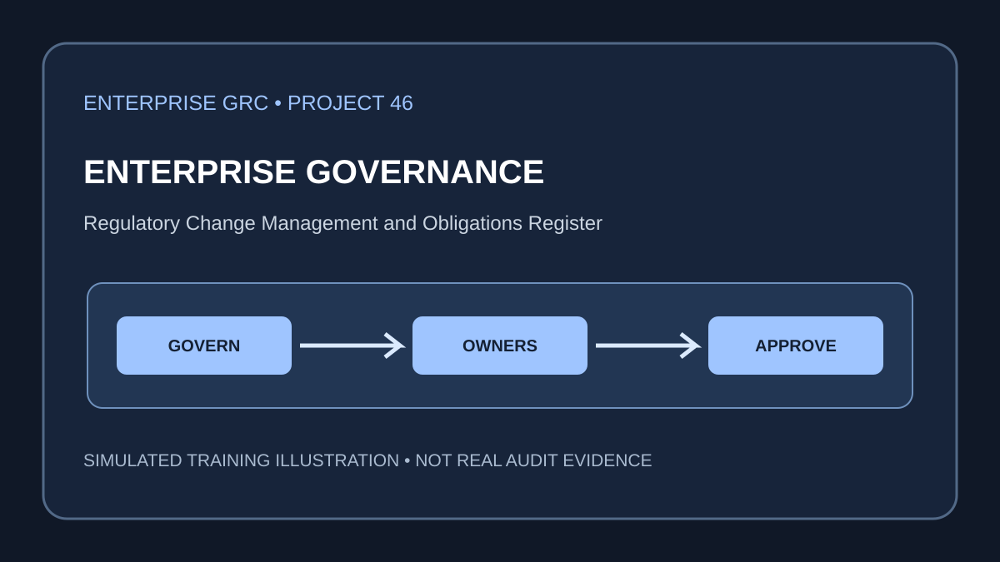

# Project 46: Regulatory Change Management and Obligations Register

**Level:** Advanced | **Track:** Enterprise GRC & Security Compliance

## Objective
Deliver an enterprise-level regulatory change management and obligations register design and implementation exercise. Demonstrate strategic alignment, governance, accountable risk decisions, evidence traceability, executive oversight, and continuous improvement.

## Scope and authorization
Use a fictional organization and synthetic data. Define legal entities, services, jurisdictions, systems, data classes, third parties, dependencies, scope boundaries, exclusions, and assumptions. Keep real sensitive or regulated information out of this public repository. This is educational, not legal advice, certification, or an audit opinion.

## Prerequisites
- Executive sponsor and stakeholder map
- Current official regulatory, contractual, and framework source material
- GRC workspace, evidence repository, workflow/diagram tools, and synthetic records
- Approved risk appetite, decision authorities, escalation paths, and review cadence

## Lab setup
1. Draft a charter with strategic outcomes, scope, constraints, assumptions, and success measures.
2. Map business services, assets, data flows, systems, third parties, and critical dependencies.
3. Establish governance roles, decision rights, risk owners, control owners, and independent reviewers.
4. Create linked registers for obligations, risks, controls, evidence, findings, exceptions, and actions.
5. Define record IDs, data quality, access restrictions, retention, review, and change-control rules.

## Walkthrough
### 1. Align strategy and obligations
Translate business strategy and applicable obligations into measurable outcomes. Record authoritative sources, editions, jurisdiction, effective dates, applicability, ownership, and change triggers.

### 2. Establish governance and accountability
Define committees, reporting lines, decision rights, escalation thresholds, approval authorities, and segregation of duties. Ensure first-line control ownership and independent oversight are clearly differentiated.

### 3. Design integrated risk and control processes
Create risk taxonomy, appetite/tolerance, scoring, aggregation, treatment, exception, and acceptance processes. Link risk scenarios to control objectives, owners, evidence, and test procedures.

### 4. Implement evidence and assurance
Define evidence ownership, collection, validation, access, retention, versioning, sampling, reviewer independence, and issue management. Preserve traceability from obligation to control, test, evidence, finding, and decision.

### 5. Exercise scenarios and decisions
Use synthetic cases to test governance under change, incident, supplier disruption, audit finding, or risk appetite breach. Record decisions, assumptions, alternatives, impacts, approvals, and follow-up actions.

### 6. Measure program performance
Define coverage, effectiveness, risk exposure, exception age, remediation velocity, resilience, and assurance metrics. Document formulas, data sources, denominators, thresholds, limitations, and accountable data owners.

### 7. Build the executive roadmap
Prioritize initiatives by risk reduction, business value, regulatory urgency, dependency, cost, and feasibility. Assign sponsors, workstream owners, milestones, resources, interim safeguards, and review gates.

## Example executive register
| ID | Strategic domain | Owner | Evidence | Status | Decision needed |
|---|---|---|---|---|---|
| EXEC-001 | Governance and scope | Sponsor | GOV-001 | Draft | Approve mandate |
| EXEC-002 | Enterprise risk | CRO / risk lead | RISK-001 | Review | Confirm appetite |
| EXEC-003 | Assurance and controls | Control owner | ASSUR-001 | Pending | Fund remediation |

## Tools and checks
Use RACI, process maps, obligation/control crosswalks, risk heat maps, dependency maps, evidence catalogs, dashboards, and action trackers. Validate unique IDs, source lineage, missing owners, stale evidence, access permissions, overdue actions, and approval history. Keep examples synthetic.

## Expected output
A board- and management-ready program pack containing charter, governance model, obligations map, risk/control architecture, evidence and assurance process, performance metrics, scenario results, and sequenced roadmap.

## Findings and risk assessment
Identify systemic governance gaps, fragmented ownership, incomplete obligation coverage, weak evidence, unapproved exceptions, concentration risk, and unmeasured residual exposure. Quantify only when data and assumptions support it; otherwise use transparent qualitative analysis.

## Framework mapping
Use applicable references from ISO/IEC 27001:2022, NIST CSF 2.0, NIST SP 800-53 Rev. 5, CIS Controls v8, SOC 2 Trust Services Criteria, and relevant laws or contracts. Record exact source editions and mapping rationale. Crosswalks are informative, not proof of equivalence or compliance.

## Remediation
Create a prioritized multi-phase roadmap with accountable sponsors, workstream owners, milestones, dependencies, resources, interim safeguards, objective outcomes, and independent validation gates. Record accepted risks with rationale, authority, expiry, and review date.

## Validation criteria
- Strategic outcomes and scope are approved
- Governance roles and decision rights are clear
- Obligations trace to controls, tests, and evidence
- Risk appetite, escalation, and acceptance are documented
- Assurance roles and evidence quality are defined
- Metrics have reproducible calculations and data owners
- Roadmap has owners, milestones, dependencies, and review gates
- Independent reviewers can reproduce sample conclusions

## Evidence and reporting checklist
- [ ] Approved charter, scope, and strategic objectives
- [ ] Governance model, RACI, and decision records
- [ ] Obligations register and framework editions
- [ ] Risk taxonomy, appetite, and risk register
- [ ] Control architecture and evidence catalog
- [ ] Test workpapers and scenario exercise records
- [ ] Metrics definitions, source lineage, and dashboard
- [ ] Remediation roadmap and executive approvals

## Training illustrations
Simulated training illustrations only; they are not actual board, audit, or operational evidence.

## Deliverables
1. Enterprise charter, scope, and governance model
2. Obligations, risk, and integrated control registers
3. Evidence and assurance operating model
4. Executive metrics and scenario decision pack
5. Prioritized roadmap with accountable owners

## Completion criteria
The enterprise design is approved, obligations and risks are traceable, decisions have accountable owners, outcomes are measurable, and an independent reviewer can validate the evidence and roadmap.
